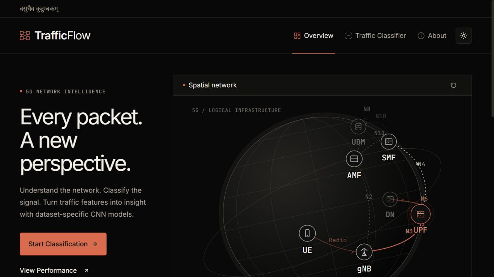
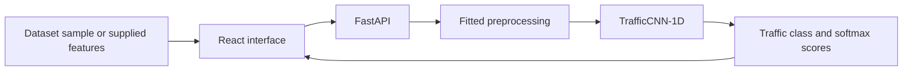

<div align="center">
  

  <h1>TrafficFlow</h1>

  <p><strong>CNN-Based Traffic Flow Classification in 5G Core Networks.</strong></p>
  <p>Explore the network. Classify the signal.</p>

  
  
  
  

  <p>
    <a href="#overview">Overview</a> ·
    <a href="#features">Features</a> ·
    <a href="#getting-started">Getting Started</a> ·
    <a href="#model-evaluation">Model Evaluation</a> ·
    <a href="#author">Author</a>
  </p>
</div>

---

## Overview

**TrafficFlow** is a full-stack machine-learning project that classifies supplied network-flow records using dataset-specific **1D convolutional neural networks**. A React interface makes it possible to load real dataset examples, inspect their features, and run single-record or batch inference through a FastAPI backend.

Built for exploring traffic classification and presenting the complete ML workflow, the project connects fitted preprocessing, trained checkpoints, evaluation results, and an interactive interface in one repository.

> The animated 5G topology is illustrative. TrafficFlow classifies supplied feature records; it does not capture live traffic or monitor real network infrastructure.

## Features

### Traffic classification

- **Five dataset configurations:** UNSW-NB15 and ISCX VPN-nonVPN with 15s, 30s, 60s, and 120s flow windows.
- **Guided examples:** load real held-out dataset records without manually entering every feature.
- **Schema-driven forms:** dataset-specific inputs with a collapsible review/edit section and input validation.
- **Single and batch inference:** classify one record or a JSON batch of 1–100 records.
- **JSON workflow:** download sample batches or blank templates, import JSON, and export prediction results.
- **Clear results:** predicted class, returned softmax confidence, and class-wise scores. Built-in examples show their original dataset labels separately.
- **Useful feedback:** loading states, invalid-input protection, and retry actions for failed requests.

### Interface and network exploration

- **Three focused pages:** Overview, Traffic Classifier, and About.
- **Custom SVG 5G globe:** rotating logical topology with UE, gNB, AMF, SMF, UPF, UDM, and DN nodes.
- **Interactive Node Inspector:** select components, inspect relationships, trace the user plane, and toggle control-plane connections.
- **Obsidian / Ember identity:** charcoal surfaces, warm typography, and restrained coral accents.
- **Dark and light themes:** persistent theme preference, responsive navigation, and mobile layouts.
- **Accessible interactions:** keyboard navigation, visible focus states, and reduced-motion support.

### Machine-learning workflow

- **TrafficCNN-1D:** separate trained CNN checkpoints for each dataset configuration.
- **Fitted preprocessing:** saved imputation, numerical scaling, categorical encoding, and original class mappings.
- **Evaluation tooling:** accuracy, precision, recall, F1, per-class reports, and confusion matrices.
- **Label-fraction experiments:** training workflows for 10%, 25%, 50%, and 100% of training labels.

## Preview



*Overview in dark mode. The globe illustrates network architecture; it is separate from CNN inference.*

## Architecture



The frontend obtains each dataset's raw feature schema from the API. The backend validates the input, applies the matching saved preprocessor, and runs the corresponding CNN checkpoint in evaluation mode. Existing class mappings determine the returned labels.

## Technology Stack

| Layer | Technologies |
| --- | --- |
| Frontend | React 19, TypeScript, Vite 8 |
| Interface | CSS, Tailwind CSS tooling, Lucide React, Motion for React |
| Network visualization | Custom SVG geometry and animations |
| API | FastAPI, Pydantic, Uvicorn |
| Machine learning | PyTorch, scikit-learn |
| Data processing | NumPy, Pandas, Joblib |
| Evaluation and plots | scikit-learn metrics, Matplotlib, Seaborn |

This project uses local model and preprocessing artifacts. A database or external AI API key is not required for the current classification workflow.

## Supported Datasets

| Configuration | API dataset key | Task | Raw features |
| --- | --- | --- | ---: |
| UNSW-NB15 | `UNSW_NB15` | Normal traffic and attack-category classification | 42 |
| ISCX 15s | `ISCX_15s` | Application and VPN/non-VPN traffic classification | 23 |
| ISCX 30s | `ISCX_30s` | Application and VPN/non-VPN traffic classification | 23 |
| ISCX 60s | `ISCX_60s` | Application and VPN/non-VPN traffic classification | 23 |
| ISCX 120s | `ISCX_120s` | Application and VPN/non-VPN traffic classification | 23 |

Feature names and types come from `GET /schema?dataset=<dataset_key>`. Records are measured flow statistics, not IP addresses, website URLs, or packet-capture files.

## Project Structure

```text
Traffic-Flow-Classification/
├── backend/
│   ├── main.py                    # FastAPI routes and CNN inference
│   ├── train_cnn.py               # Dataset and label-fraction experiments
│   ├── evaluate_all_datasets.py   # Evaluation of serving checkpoints
│   ├── models/                   # Trained checkpoints
│   ├── results/                  # Stored evaluation metrics and figures
│   └── test_*.py                 # API and artifact checks
├── datasets/
│   ├── preprocess_dataset.py     # Dataset preparation and fitted pipelines
│   ├── verify_dataset.py         # Processed-data checks
│   └── processed/                # Preprocessors and local data.npz splits
├── evaluation_results/           # Additional evaluation and candidate-model reports
├── frontend/
│   ├── public/                   # Favicon and public assets
│   ├── src/
│   │   ├── components/           # Navigation, theme, globe, and shared UI
│   │   ├── data/                 # Real classifier demo examples
│   │   ├── pages/                # Overview, Traffic Classifier, About
│   │   └── services/             # Backend API client
│   ├── scripts/                  # Route and API contract checks
│   ├── .env.example
│   └── package.json
├── docs/images/                  # README screenshots
├── requirements.txt
└── README.md
```

## Getting Started

### Prerequisites

- **Python 3.11** and a virtual environment.
- **Node.js 22.18+** with npm.
- Matching model checkpoints and fitted preprocessors for the five configurations.

The commands below use **Windows PowerShell**, matching the project's development environment. The pinned Python requirements include Windows-specific packages.

### 1. Clone the repository

```powershell
git clone https://github.com/mrsingh1072/Traffic-Flow-Classification.git
cd Traffic-Flow-Classification
```

### 2. Install Python dependencies

From the project root:

```powershell
python -m venv venv
.\venv\Scripts\python.exe -m pip install -r requirements.txt
.\venv\Scripts\python.exe -m pip check
```

### 3. Start the backend

```powershell
cd backend
..\venv\Scripts\python.exe -m uvicorn main:app --reload --host 127.0.0.1 --port 8000
```

Leave this terminal running. Interactive API documentation is available at [http://127.0.0.1:8000/docs](http://127.0.0.1:8000/docs).

### 4. Start the frontend

Open another terminal at the project root:

```powershell
cd frontend
npm ci
npm run dev -- --host 127.0.0.1 --port 5173 --strictPort
```

Open **[http://127.0.0.1:5173](http://127.0.0.1:5173)**.

The API URL defaults to `http://127.0.0.1:8000`. To change it, create `frontend/.env` using `frontend/.env.example`:

```dotenv
VITE_API_BASE_URL=http://127.0.0.1:8000
```

For a different frontend origin, set the backend's `FRONTEND_ORIGINS` environment variable to a comma-separated list of allowed origins. Restart the affected server after changing environment settings.

### Required local artifacts

Each dataset uses these matching files:

```text
backend/models/<dataset_key>_100pct/model.pt
datasets/processed/<dataset_key>/preprocessor.joblib
```

For example, UNSW-NB15 uses `backend/models/UNSW_NB15_100pct/model.pt` and `datasets/processed/UNSW_NB15/preprocessor.joblib`. Check [the health endpoint](http://127.0.0.1:8000/health) for missing artifacts.

Raw CSV/ARFF datasets and processed `.npz` splits are excluded from Git. **Running inference with existing checkpoints and preprocessors does not require retraining.** Reproducing training or evaluation also requires the corresponding local data splits.

## Demo Workflow

1. Open **Traffic Classifier** and select a dataset.
2. Choose a **Demo record** and click **Load example**.
3. Optionally expand **Review or edit features** to inspect the supplied values.
4. Click **Classify Traffic** to obtain a real backend prediction.
5. Compare the model prediction with the original label shown for an unedited built-in example.

For batch inference, switch to **Batch JSON** and choose **Load sample batch**. Alternatively, use **Download sample JSON**, import that same file for the selected dataset, and classify it. Batch files contain a JSON array of feature objects; use `null` for missing values and include every schema field.

Built-in examples are sampled from held-out records, not selected for prediction correctness. Their original labels are separate from the model's output. A model can misclassify an example.

## Model Evaluation

The table below summarizes the **stored held-out results for the serving 100% training-label checkpoints**. Values are rounded from the existing [evaluation artifacts](backend/results/all_datasets_evaluation); they are not live statistics or newly generated results.

| Dataset | Test samples | Accuracy | Macro F1 |
| --- | ---: | ---: | ---: |
| UNSW-NB15 | 55,945 | 71.96% | 40.97% |
| ISCX 15s | 3,615 | 60.97% | 50.69% |
| ISCX 30s | 2,728 | 61.40% | 53.44% |
| ISCX 60s | 2,946 | 53.05% | 41.67% |
| ISCX 120s | 1,919 | 57.48% | 43.52% |

Each checkpoint is evaluated on its corresponding saved test split with the original class ordering. Test arrays are already preprocessed. Training and validation data are excluded from final test metrics; inference uses `model.eval()` and `torch.no_grad()`.

These datasets represent different tasks, so their scores are not directly comparable. Aggregate accuracy can conceal weaker minority-class detection. Softmax confidence is not a calibrated probability or a guarantee of correctness.

Additional improvement experiments and candidate checkpoints are documented in [evaluation_results](evaluation_results/). They are separate from the models selected by `backend/main.py`; their presence does not change the serving model.

### Reproduce experiments

Obtain the source datasets under their respective access terms. The preprocessing script expects:

- UNSW-NB15 training/testing CSVs under `datasets/CSV Files/Training and Testing Sets/`.
- ISCX `TimeBasedFeatures-Dataset-{15s,30s,60s,120s}.arff` files under `datasets/Scenario B-ARFF/`.

From the project root, run the relevant step explicitly:

```powershell
# Prepare splits and fitted preprocessors from source datasets.
.\venv\Scripts\python.exe datasets/preprocess_dataset.py

# Train the five dataset configurations at four label fractions.
.\venv\Scripts\python.exe backend/train_cnn.py

# Evaluate the serving 100% training-label checkpoints on saved test splits.
.\venv\Scripts\python.exe backend/evaluate_all_datasets.py
```

These commands generate or update artifacts; they are **not required for the guided demo**. Preserve matching preprocessors, class mappings, model checkpoints, and original splits when reproducing results. Evaluation outputs are written to `backend/results/all_datasets_evaluation/`.

## API Reference

| Method | Endpoint | Purpose |
| --- | --- | --- |
| GET | `/health` | Model and preprocessor readiness |
| GET | `/datasets` | Five configured datasets and artifact availability |
| GET | `/schema?dataset=UNSW_NB15` | Raw feature names and types for the selected dataset |
| POST | `/predict` | Classify one feature record using `dataset` and `features` |
| POST | `/predict/batch` | Classify 1–100 records using `dataset` and `records` |
| GET | `/metrics` | Stored dataset-level evaluation summaries |
| GET | `/metrics/{dataset}/classes` | Per-class precision, recall, F1, and support |
| GET | `/metrics/{dataset}/confusion-matrix` | Confusion-matrix labels and counts |

See [FastAPI Swagger documentation](http://127.0.0.1:8000/docs) for request and response schemas while the backend is running. Detailed evaluation remains available through the API and saved reports; it is not a separate frontend page.

## Verification

From the project root:

```powershell
# Frontend route checks and TypeScript/production build.
npm --prefix frontend run test:routes
npm --prefix frontend run build

# API checks: start the backend first and retain its required artifacts.
.\venv\Scripts\python.exe backend/test_backend_ready.py
.\venv\Scripts\python.exe backend/test_api_validation.py
.\venv\Scripts\python.exe backend/test_all_datasets.py
.\venv\Scripts\python.exe frontend/scripts/verify_api.py
```

The current frontend routes are `#/overview`, `#/classifier`, and `#/about`.

## Scope and Future Work

TrafficFlow is a portfolio and academic project for demonstrating dataset-based CNN classification. It does not currently capture live traffic, inspect a deployed 5G network, or provide a production intrusion-detection service.

Possible future work includes class-imbalance improvements, confidence calibration, independent evaluation on new data, and a separately designed traffic-capture integration. Authentication, deployment hardening, and operational monitoring are outside the current implementation.

## Contributing

1. Fork the repository and create a focused branch.
2. Keep changes consistent with the existing dataset schemas and preprocessing contracts.
3. Run the checks relevant to your changes and document their results.
4. Open a pull request explaining the change and its effect.

Dataset access and redistribution remain subject to the original providers' terms. Only load trusted model and preprocessing artifacts.

## Author

**Saurabh**

[GitHub](https://github.com/mrsingh1072) · [LinkedIn](https://www.linkedin.com/in/saurabh-singh-959b48323/) · [Instagram](https://www.instagram.com/mr__singh1072/)

For questions or bugs, [open an issue](https://github.com/mrsingh1072/Traffic-Flow-Classification/issues).

---

<div align="center">
  <strong>Made with ❤️ by Saurabh</strong><br />
  <sub>Designed and developed with curiosity, passion, and a love for technology.</sub>
</div>
